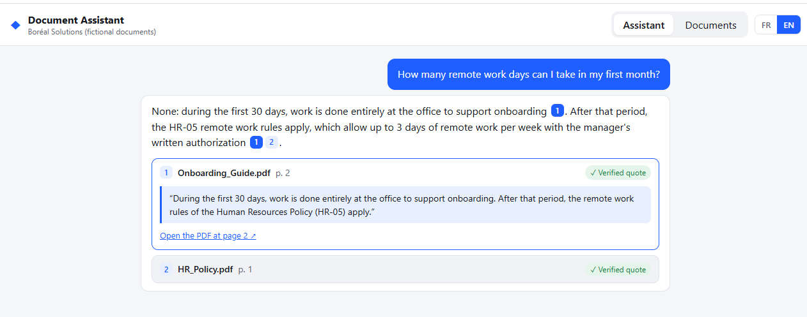
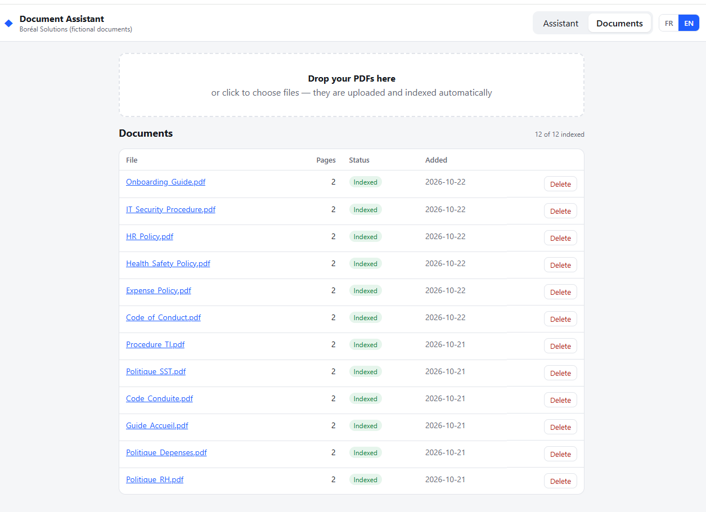
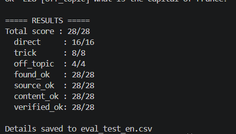

# Internal Document Assistant (RAG) — with verified citations

A bilingual question-answering assistant for company documents. Employees ask a question in French or English; the assistant answers **only from the company's PDFs**, cites the **file, page and exact sentence** it relied on, and says so when the answer is not in the documents.

> Demo project. All documents (Boréal Solutions inc.) are fictional and were written to test the system.


## The problem

Policies, onboarding guides and procedures are spread across dozens of PDFs. Employees either search manually, ask HR the same questions again, or trust a generic chatbot that may invent an answer. For internal policies, a wrong but confident answer is worse than no answer.

## What it does

- **Answers grounded in documents only** — no general knowledge, no guessing.
- **Verifiable citations** — every answer links to the file and page, and quotes the exact sentence. The backend checks that the quote really exists word for word in the document (`verified: true`) and fixes the reference if the model points to the wrong passage.
- **Refuses when the information is missing** — "I can't find this information in the documents."
- **Bilingual** — answers in the language of the question (French or English), even when the source document is in the other language. Quotes stay in the original language so they can be verified.
- **Handles cross-document questions** — e.g. vacation entitlement is in the HR policy, but the onboarding guide says vacation can't be taken during probation.
- **Document management** — drag-and-drop PDF upload, automatic indexing, re-index and delete.
- **Agent mode** — Claude chooses its own read-only tools (list documents, search content), every run is logged, and destructive requests are refused.
- **Secured API** — sign-in with Supabase Auth, admin and employee roles checked on every FastAPI route (401 / 403), per-user rate limit (429), and database tables locked with row-level security.
- **Automated evaluation** — 55 test questions for the Q&A route, plus a separate test set for the agent (tool choice and safety).

## Architecture

```
PDF upload ──► PyMuPDF (text per page) ──► chunking per page (≈1000 chars, 200 overlap)
                                                  │
                                                  ▼
                                   OpenAI embeddings (text-embedding-3-small)
                                                  │
                                                  ▼
                              Supabase PostgreSQL + pgvector (HNSW, cosine)

Question ──► embedding ──► top-5 passages (similarity ≥ 0.25)
                                  │
                       none ──────┴────── found
                        │                   │
                 "not found"        Claude (JSON: answer + citations + exact quotes)
                                            │
                                  quote verification against the passage
                                            │
                                            ▼
                         answer + sources (file, page, quote, verified)
```

| Layer | Technology |
|---|---|
| API | Python, FastAPI (Swagger at `/docs`) |
| PDF extraction | PyMuPDF |
| Database & vector search | Supabase PostgreSQL + pgvector |
| Embeddings | OpenAI `text-embedding-3-small` (multilingual) |
| Answer generation | Anthropic Claude API |
| Frontend | React + TypeScript + Vite, FR/EN switch (`frontend/`) |

**Design choices**
- Text is split **page by page**, so every passage keeps an exact page number for citations.
- Retrieved passages are treated as data, not instructions (basic prompt-injection guard).
- A similarity threshold stops off-topic questions before the model is even called.
- Claude returns structured JSON; the parser reads the first complete JSON object and ignores trailing text.

## Evaluation

`eval.py` sends every question of a test file to `/ask` and checks four things:

| Check | Meaning |
|---|---|
| `found_ok` | Answers when it should, refuses off-topic questions |
| `source_ok` | Cites the expected file and page |
| `content_ok` | The answer contains the expected facts (e.g. "0.62") |
| `verified_ok` | Every quote exists word for word in the cited passage |

The test sets include direct questions, **trick questions** (rules split across two documents, false premises, the same word with different meanings, a gift card under the dollar limit but forbidden anyway) and **off-topic questions** that must be refused. The index holds 12 documents: 6 in French and their 6 English versions.

| Test set | Direct | Trick | Off-topic | Total |
|---|---|---|---|---|
| French (27 questions) | 15/15 | 8/8 | 4/4 | **27/27** |
| English (28 questions) | 16/16 | 8/8 | 4/4 | **28/28** |

The first French runs scored 25/27, then 26/27. The failures led to two fixes: re-matching a quote to the right passage when the model used the wrong reference number, and tolerating text after the JSON. LLM output varies slightly between runs, so the evaluation should be run several times after each change.

```powershell
python eval.py questions_test.json      # French  -> eval_test.csv
python eval.py questions_test_en.json   # English -> eval_test_en.csv
```

## Agent mode (v2)

`POST /agent` turns the assistant into a small agent. Claude receives two **read-only** tools and decides which ones to call, possibly several times, before answering:

| Tool | What it does |
|---|---|
| `list_documents` | Lists the indexed documents (file, pages, status) |
| `search_documents(query)` | Semantic search, same engine as `/ask` |

```
Question ──► Claude (tool use) ──► list_documents / search_documents ──► Claude ──► … (max 4 rounds)
                                                                                │
                                         final JSON answer + quotes ◄───────────┘
                                                      │
                                     same quote verification as /ask
                                                      │
                                answer + sources + tools used ──► agent_runs (log)
```

**Safety by design**
- The agent has **no write tool**: it cannot delete, modify, upload or send anything. Requests such as "Delete the HR policy" or prompt-injection attempts are refused, and the evaluation checks that the document count is unchanged afterwards.
- Tool results are treated as data, not instructions.
- After 4 tool rounds, tools are disabled to force a final answer (no infinite loops).
- Every run is stored in `agent_runs` (question, tools and arguments, result, duration) and can be read at `GET /agent/runs`.

In the interface, the **Agent mode** switch sends questions to `/agent` and shows which tools were used under each answer.

```powershell
python eval_agent.py   # tool choice, content, off-topic and safety checks
```

## Security (v3)

Access control is enforced **in FastAPI**, not only hidden in the interface.

| Route | No token | Employee | Admin |
|---|---|---|---|
| `GET /me`, `GET /documents`, `GET /documents/{id}/file` | 401 | ✅ | ✅ |
| `POST /ask`, `POST /agent`, `GET /search` | 401 | ✅ rate-limited | ✅ |
| `POST /documents`, `DELETE /documents/{id}`, `POST /documents/{id}/index` | 401 | 403 | ✅ |
| `GET /agent/runs` | 401 | 403 | ✅ |

- **Authentication:** Supabase Auth (email + password). The frontend sends the user's token; the backend verifies it with Supabase on each request (cached 60 s).
- **Roles:** stored in a `profiles` table and read by the backend. The interface only hides admin buttons for convenience; the server decides.
- **Rate limit:** 10 questions per minute and 200 per day per employee (configurable), `429` with `Retry-After`. Admins are not limited.
- **Database lockdown:** the frontend holds the public Supabase key, so every table has row-level security enabled with no policy, and the vector search function can only be called by the backend. All data goes through FastAPI.
- **Tests:** `python test_security.py` checks every route without a token, with an invalid token, as an employee and as an admin, plus the rate limiter. None of the checks deletes data or calls the AI.

**Not covered yet: multi-company isolation.** For several companies on one installation, documents, pages and chunks need an `organization_id`, the vector search must filter on the caller's organization (taken from their profile, never from the request), and tests must prove that one company cannot retrieve another company's passages.

## Run it locally

**Requirements:** Python 3.11+, Node.js 18+, a Supabase project, OpenAI and Anthropic API keys.

**1. Database** — in Supabase > SQL Editor, run `supabase/schema.sql` (tables, vector search, agent log, security). Create two users in Authentication > Users, then set their roles with `supabase/security.sql`.

**2. Backend**
```powershell
python -m venv .venv
.venv\Scripts\Activate.ps1
pip install -r requirements.txt
copy .env.example .env      # then fill in the keys and the two test accounts
python -m uvicorn app.main:app --reload
```
API docs: http://localhost:8000/docs

**3. Load the sample documents**
```powershell
python import_docs.py docs_test
python import_docs.py docs_test_en
python test_security.py
```
After changing the chunking, re-index everything with `python import_docs.py docs_test --reindex` (same for `docs_test_en`).

**4. Frontend** (in `frontend/`)
```powershell
copy .env.example .env.local   # Supabase URL + publishable key
npm install
npm run dev
```
Open http://localhost:5173

## API

| Method | Route | Purpose |
|---|---|---|
| POST | `/documents` | Upload a PDF, extract its pages |
| GET | `/documents` | List documents and status |
| GET | `/documents/{id}/file` | Serve the PDF (used for "open at page N") |
| DELETE | `/documents/{id}` | Delete a document, its pages and its vectors |
| POST | `/documents/{id}/index` | Chunk, embed and store vectors |
| GET | `/search?q=` | Debug: raw nearest passages |
| POST | `/ask` | Question → answer with verified citations |
| POST | `/agent` | Question → agent picks tools → answer with verified citations + tools used |
| GET | `/agent/runs` | Agent log: latest runs (admin) |
| GET | `/me` | Signed-in user and role |

## Project structure

```
app/
  main.py         FastAPI routes
  db.py           Supabase client
  pdf.py          page extraction
  chunking.py     page-level chunking with overlap
  embeddings.py   OpenAI embeddings (batched)
  answer.py       prompt, language handling, JSON parsing, quote verification
  retrieval.py    vector search shared by /ask and the agent
  agent.py        agent loop, tools, run log
  security.py     authentication, roles, rate limit
supabase/schema.sql
frontend/         React interface (see frontend/README.md)
docs_test/        fictional company documents (French)
docs_test_en/     the same documents in English
questions_test.json / questions_test_en.json
eval.py           automated evaluation (/ask)
eval_agent.py     agent evaluation (tool choice + safety)
test_security.py  401 / 403 / 429 checks on every route
client_auth.py    sign-in helper for the scripts
questions_agent.json
import_docs.py    bulk upload + indexing
```

## Next steps

- Public read-only demo (rate limiting, upload disabled)
- Multi-company isolation (organization_id + filtered vector search)
- Write actions with human confirmation (agent prepares, a person confirms in the UI)
- Expose the tools as an MCP server
- Role-based access (e.g. HR documents visible to HR only)
- Section-aware chunking (split on headings such as `HR-03`)
- OCR for scanned PDFs
- Automatic ingestion from Google Drive or SharePoint with n8n
- Conversation history (follow-up questions)

## Screenshots

| | |
|---|---|
|  |  |
|  |  |
