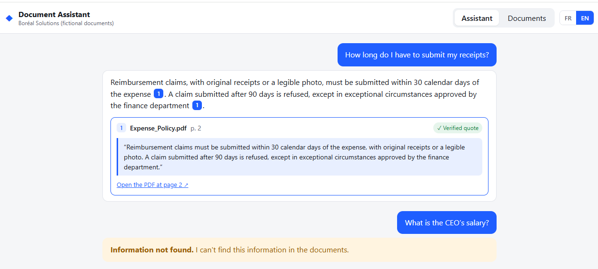

# Document Assistant — React frontend

Web interface for the RAG backend. See [the main README](../README.md) for the full project.



## Features

**Assistant**
- Ask questions in French or English; answers come only from the uploaded documents.
- Clickable citation numbers `[1]` in the answer.
- Each source shows the file, the page, the exact quoted sentence and a **Verified quote** badge.
- "Open the PDF at page N" opens the source document at the right page.
- Clear "Information not found" state when the documents don't contain the answer.

**Documents**
- Drag-and-drop PDF upload; each file is uploaded and indexed automatically, with per-file progress.
- Document list with page count, status (indexed / not indexed / error), re-index and delete.

**General**
- FR / EN switch for the whole interface (remembered between visits, defaults to the browser language).
- Automatic light / dark theme.

## Run locally

The FastAPI backend must be running on `http://127.0.0.1:8000` (see `../README.md`).

```powershell
npm install
npm run dev
```

Open http://localhost:5173

In development, Vite proxies `/api/...` to `http://127.0.0.1:8000` (see `vite.config.ts`), so no CORS setup is needed. For a deployed version, the API URL and CORS must be configured.

## Stack

React 18 · TypeScript · Vite · plain CSS (no UI library)

## Structure

```
src/
  api.ts                    calls to the backend
  types.ts                  response types
  i18n.ts                   French / English texts
  App.tsx                   header, tabs, language switch
  components/Chat.tsx       chat, citations, source cards
  components/Documents.tsx  upload, list, re-index, delete
  styles.css                light / dark theme
```
